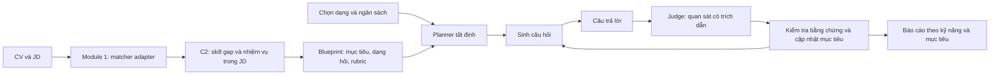

# Phỏng vấn theo bằng chứng — V2

Phạm vi: phân tích yêu cầu, lập kế hoạch, phỏng vấn thích nghi và báo cáo. Không triển khai module ôn luyện, ghi chú hoặc SBERT/GNN thật.

## Pipeline và trách nhiệm

- `module1_matcher`: giữ nguyên contract `w_j` và `soft_match`; adapter hiện tại ghi `matcher_source:MOCK_LLM` hoặc `MOCK_HEURISTIC` vào flags của C2. Implementation SBERT/GNN sau này thay qua `Module1MatcherProtocol`, không thay planner. Giá trị mock không phải kết quả nghiên cứu của metric mới.
- `skill_gap`: bổ sung `job_tasks`, trích dẫn JD, lý do mức yêu cầu, trọng số quan trọng, độ bao phủ bằng chứng CV, cờ recency/degraded. Giữ công thức gap và priority hiện có. Thứ tự suy luận mức yêu cầu: nhiệm vụ/độ sâu rõ ràng → kinh nghiệm riêng của kỹ năng → seniority fallback. Optional không đồng nghĩa mức thấp.
- `evidence/provider.py`: interface LLM cho blueprint, question, judge. Không tải compiled artifact C3 cũ. Câu hỏi, rubric và kết luận của LLM đều phải qua kiểm tra trước khi lưu.
- `planning.py`: mỗi nhiệm vụ có mục tiêu riêng; ID ổn định theo skill/task. Blueprint phủ đúng yêu cầu đầu vào. Nhóm core được ưu tiên trước; trong nhóm core dùng gap priority rồi importance. MATCH core vẫn được xác minh. Ưu tiên một lượt trên các kỹ năng, giữ phần ngân sách cho follow-up và có thể đưa mục tiêu chưa hỏi trở lại khi còn ngân sách.
- `assessment.py`: kiểm tra trích dẫn nguyên văn, criterion IDs và tính hợp lệ của judgment; tổng hợp bằng chứng; quyết định clarification/follow-up/easier/deeper/contradiction verification. Belief chỉ là tín hiệu phụ, không quyết định đủ bằng chứng.
- `workflow.py`: chuyển trạng thái trên bản sao sâu. Lỗi judge/generator không làm thay đổi snapshot đã lưu. Giới hạn thời gian, tổng số câu và số câu/mục tiêu; dành cơ hội ban đầu cho các mục tiêu còn lại.
- `reporting.py`: projection thuần từ snapshot. Kết luận theo mục tiêu, nhóm theo kỹ năng trên UI; mỗi bằng chứng có `turn_id` và trích dẫn câu trả lời.

## Dạng phỏng vấn

`MIXED` cho phép các dạng phù hợp với nhiệm vụ. `FOCUSED` chỉ chọn mục tiêu hỗ trợ dạng người dùng chọn. Các dạng: `CODING`, `DEBUGGING`, `DESIGN` (architecture/system design), `TECHNICAL_EXPLANATION`, `BEHAVIORAL`.

Một mục tiêu có nhiều `suitable_modes` cùng lý do và coverage theo criterion. MIXED chọn theo task fit → coverage essential criteria → dạng ít được dùng hơn → thứ tự blueprint khi hòa. FOCUSED giữ đúng lựa chọn người dùng. Mode được khóa trong từng objective. Không có mục tiêu phù hợp thì trả lỗi rõ ràng để người dùng đổi dạng.

Độ sâu câu hỏi có thang riêng: L1 Foundation, L2 Application, L3 Analysis/Problem Solving, L4 Design/Trade-offs. `required_proficiency` vẫn là thang C2 1–5. `target_depth` được khóa theo nhiệm vụ; `current_question_depth` chỉ thay đổi độ sâu của câu đang hỏi. Câu đầu ở target, câu chẩn đoán thấp hơn một mức, câu mở rộng chỉ dùng khi có `extension_depth`, anchor cao hơn và cấu hình cho phép. Không yêu cầu đi qua từng mức. Chi tiết audit, thuật toán, cấu hình và ví dụ phiên đầy đủ ở [evidence-interview-v2-audit.md](evidence-interview-v2-audit.md).

## Ý nghĩa kết luận

| Trạng thái | Ý nghĩa |
|---|---|
| `NOT_ASSESSED` | Chưa đánh giá câu trả lời nào cho mục tiêu |
| `INSUFFICIENT_EVIDENCE` | Thiếu tiêu chí thiết yếu hoặc còn bằng chứng mâu thuẫn |
| `NOT_DEMONSTRATED` | Mọi tiêu chí thiết yếu có thất bại được đối chiếu qua các ngữ cảnh độc lập và chẩn đoán; chưa có thể hiện thành công ở target hoặc thấp hơn. Không yêu cầu ứng viên phải nói “không biết”, không khẳng định họ thiếu toàn bộ kỹ năng |
| `DEMONSTRATED_BELOW_TARGET` | Các tiêu chí thiết yếu được quan sát đủ; thất bại ở target có bằng chứng chẩn đoán đối chiếu. Một câu sai đơn lẻ vẫn là thiếu bằng chứng |
| `DEMONSTRATED_AT_TARGET` | Đủ bằng chứng thiết yếu, đáp ứng mức yêu cầu |
| `DEMONSTRATED_ABOVE_TARGET` | Đã đạt target và đáp ứng anchor cao hơn được định nghĩa từ blueprint tại extension depth; trả lời dài hoặc tốt ở target chưa đủ |

Câu trả lời ngắn không tự động bị hạ điểm. Evidence ledger giữ cả thuận/nghịch, độ sâu, assistance và ngữ cảnh; evidence dễ hơn hoặc có HINT không xác nhận target. Hint trong feedback cũng được theo dõi cho lượt sau. Mâu thuẫn chỉ được xóa qua `VERIFY_CONTRADICTION` có bằng chứng giải quyết. Hết lượt/thời gian là lý do dừng, không phải điều kiện chứng minh năng lực. Sai câu mở rộng không xóa bằng chứng đã đạt target.

## Hỏi từng tiêu chí và đào sâu thích nghi

Một kỹ năng có thể có nhiều mục tiêu theo nhiệm vụ JD; mỗi mục tiêu có nhiều tiêu chí. Mỗi lượt mới chỉ nhắm đúng **một** tiêu chí, do bộ điều phối chọn trước khi gọi LLM. Generator chỉ nhận rubric của tiêu chí đó, `probe_reason` và phần bằng chứng còn thiếu. Prompt cấm gộp các nhiệm vụ độc lập; validator chặn nhiều criterion IDs, nhiều dấu hỏi ngoài code và các danh sách yêu cầu đánh số/gạch đầu dòng rõ ràng, rồi sinh lại trong giới hạn retry. Đây là kiểm tra cấu trúc và heuristic, chưa phải bộ xác minh ngữ nghĩa đầy đủ cho mọi cách diễn đạt.

Validator bỏ qua dấu hỏi trong URL và literal được trích dẫn không có khoảng trắng; danh sách điều kiện đầu vào dạng “Nếu chuỗi rỗng, trả về False” không tự bị coi là nhiều yêu cầu trả lời. Khi sinh câu hỏi không hợp lệ, mỗi retry nhận `required_question_contract` với metadata chính xác và `validation_error` chỉ rõ điều kiện sai (mode, depth, tiêu chí, scope, câu gộp hoặc lặp). Log ghi lý do từng lần, không ghi câu trả lời hoặc toàn bộ câu hỏi. Không tự đổi nhãn mode/depth/criterion của đầu ra sai để vượt kiểm tra.

Hết retry là `QuestionUnavailableError` → HTTP 503 với thông báo tiếng Việt, không còn trả lỗi yêu cầu 422 hoặc chuỗi kỹ thuật `Question generation failed validation after bounded retry` cho ứng viên. Snapshot đầu vào và dữ liệu đã lưu giữ nguyên; UI giữ bản nháp/request ID để gửi lại. Ngày 08/11/2026 đã kiểm chứng 260 kiểm thử Python, bao gồm lỗi tạo câu tiếp theo, gửi lại không đếm trùng, scope clarification và dữ liệu chứa dấu hỏi/danh sách điều kiện. Log của lần lỗi cũ chỉ có HTTP 422 nên chưa xác định được ràng buộc cụ thể đã bị vi phạm trong lần đó.

`criterion_progress` lưu riêng số lượt, clarification/easier/extension, các phần chưa xác minh, số lượt không tiến triển, những case đã quan sát và lý do dừng. Cờ tổng ở objective được giữ cho tương thích/telemetry, không còn tiêu hao cơ hội hỏi làm rõ hoặc chẩn đoán của tiêu chí khác. Snapshot cũ thiếu counters được khôi phục từ các lượt đã lưu khi tiếp tục trả lời.

Sau mỗi câu trả lời: ưu tiên giải quyết mâu thuẫn, quay về target sau chẩn đoán thành công, chuyển tiêu chí khi đã đủ bằng chứng, hoặc hỏi tiếp đúng phần chưa rõ. Judge trả `unresolved_aspects` cho bằng chứng chưa đầy đủ; không được vừa đánh dấu đạt anchor vừa khai báo phần bắt buộc còn thiếu. Một follow-up không mặc định tăng độ khó. Extension chỉ bật bằng policy, với anchor cao hơn đã khóa; từng tiêu chí được hỏi riêng.

Các mặc định là heuristic vận hành, chưa được hiệu chuẩn trên người dùng:

| Giới hạn | Mặc định | Ý nghĩa |
|---|---|---|
| `criterion_soft_limit` (policy) | 3 | Mốc xem xét tiến triển và nhường lượt cho tiêu chí/kỹ năng chưa được phủ; không tự đóng tiêu chí |
| `max_stagnant_turns` (policy) | 2 | Từ mốc mềm, dừng tiêu chí nếu không có bằng chứng thực chất ở case mới hoặc thay đổi phần chưa rõ trong số lượt liên tiếp này |
| `max_turns_per_criterion` (policy) | 6 | Giới hạn cứng cho một tiêu chí, gồm cả làm rõ/chẩn đoán/mở rộng |
| `max_questions_per_objective` (config) | 8 | Giới hạn cứng cả mục tiêu; cho phép cấu hình 1–40, vẫn chịu ngân sách toàn phiên |
| `max_questions` / `duration_seconds` | 10 / 900 | Giới hạn cứng toàn phiên |

Phần chưa rõ thay đổi được nhận biết bằng danh sách đã chuẩn hóa, không dùng điểm confidence chưa hiệu chuẩn. Thay đổi cách mô tả gap vẫn có thể bị coi là tiến triển; giới hạn cứng ngăn chuỗi hỏi kéo dài. Case giống nhau ở cùng độ sâu không được tính lại là case mới. Các giá trị policy được cấu hình bằng `EVIDENCE_POLICY_JSON` và giữ trong snapshot; giới hạn cứng tiêu chí không được nhỏ hơn mốc mềm.

Nếu còn mục tiêu khác, hệ thống nhường cơ hội ban đầu trước khi dùng hết ngân sách và luân chuyển sau mốc mềm, giữ nguyên bằng chứng/counters để quay lại. Trong mục tiêu, ưu tiên tiêu chí thiết yếu chưa hỏi sau mốc mềm trước khi tiếp tục đào sâu tiêu chí cũ. Dừng vì `NO_PROGRESS`, `CRITERION_BUDGET`, thời gian hoặc số câu không tự sinh kết luận yếu: phần chưa xác minh vẫn là chưa đủ bằng chứng. Báo cáo bổ sung `objectives[].criteria` với kết luận, số lượt và lý do dừng từng tiêu chí; rubric/anchor không được đưa vào pending turn.

Config đã lưu, kể cả giới hạn 3 lượt của phiên cũ, được giữ nguyên. Để dùng mặc định 8 lượt/mục tiêu, bắt đầu phiên mới. Không sửa DB hoặc tự tăng ngân sách phiên đang chạy.

## Nhận xét ngắn và chuyển tiếp hội thoại

Sau khi chấm câu trả lời, Judge tạo một câu nhận xét tiếng Việt, tối đa 300 ký tự, dựa trên ý ứng viên thực sự đã nêu hoặc phần diễn đạt chưa rõ. Không khen chung chung, công bố điểm/kết luận đạt-trượt, tiết lộ rubric, hướng dẫn đáp án hay hỏi thêm trong phần nhận xét. Nếu phản hồi quá dài, dùng cơ chế retry judgment hiện có; không tính thành lượt phỏng vấn mới.

Sau khi bộ điều phối chọn câu hỏi tiếp theo, `conversation.py` ghép nhận xét với một lời dẫn phù hợp: làm rõ, kiểm chứng, chẩn đoán, mở rộng, chuyển khía cạnh hoặc chuyển kỹ năng. Phần này được lưu riêng ở `Turn.introduction` và public `pending_turn.introduction`; `question` vẫn chỉ là nhiệm vụ cần trả lời. Trình tự là **nhận xét → lời chuyển tiếp → một câu hỏi mới**. Câu đầu không có nhận xét về câu trả lời chưa tồn tại. Phản hồi bị đánh dấu chứa gợi ý được thay bằng lời ghi nhận trung tính ở public feedback và introduction.

TEXT hiển thị phần này trực tiếp trước câu hỏi, không yêu cầu mở mục thu gọn. VOICE đọc introduction và câu hỏi trong cùng một yêu cầu TTS; backend chỉ lấy nội dung đã lưu sau khi kiểm tra chủ phiên, turn/version và thời hạn. Không thêm lượt hỏi, không gọi thêm LLM để tạo lời dẫn. Reload giữ nguyên introduction; snapshot cũ thiếu trường này vẫn đọc được với mặc định rỗng.

Kiểm chứng phần hội thoại ngày 08/11/2026: 251 kiểm thử Python, 12 kiểm thử backend (voice/contract/AI client), TypeScript, ESLint và production build đạt. Browser fixtures xác minh phản hồi hiển thị trước câu hỏi qua 15 lượt, giữ sau reload, bố cục desktop/mobile và hồi quy luồng voice với cùng số yêu cầu TTS. Chưa chạy nhận xét hoặc phát âm bằng LLM/TTS thật trong đợt này.

`progress` đo số mục tiêu đã đóng. `evidence_coverage` đo tiêu chí có bằng chứng được chấp nhận và không còn mâu thuẫn, trên các mục tiêu được chọn. `target_attainment` chỉ tính trên mục tiêu đã quan sát đủ mức thể hiện; trả `null` nếu chưa có mục tiêu như vậy. Các mục tiêu ngoài dạng/ngân sách vẫn xuất hiện với lý do loại trừ và không bị tính là yếu.

## API, lưu trữ và đồng thời

Public backend: `/api/v2/sessions/{sessionId}/interview`.

| API | Đầu vào |
|---|---|
| `GET /` | Khôi phục public state từ DB |
| `POST /start` | mode, focused_question_mode, duration_seconds, max_questions, max_questions_per_objective |
| `POST /respond` | request_id UUID, turn_id, expected_state_version, candidate_response |
| `POST /stop` | request_id UUID, expected_state_version |
| `GET /report` | Báo cáo từ cùng snapshot |

Backend kiểm tra chủ sở hữu trước khi trả state hoặc receipt. Frontend gửi qua service `evidenceInterview` và axiosClient theo cấu hình kết nối backend hiện tại; component không gọi HTTP trực tiếp.

Migration `V2__evidence_interviews.sql` thêm:

- `interview_runs`: một snapshot có version, config và public projection cho mỗi session.
- `interview_commands`: receipt theo `(session_id, request_id)` kèm hash payload, bảo đảm retry không ghi trùng.
- `session_turns.external_turn_id`: khóa duy nhất để projection transcript không tạo lượt trùng.

AI service chỉ tính toán: `/api/v2/interview/start`, `/respond`, `/stop`. Backend gửi snapshot đã lưu; client không được cung cấp snapshot thay thế. Những endpoint AI này là giao tiếp nội bộ, cần giữ trong mạng backend khi triển khai.

Gọi LLM diễn ra ngoài transaction DB. Khi commit, khóa hàng session, kiểm tra version, ghi snapshot + transcript + trạng thái session + receipt trong một transaction. Nếu hai yêu cầu khác nhau cùng version đến đồng thời, chỉ một yêu cầu commit; yêu cầu còn lại nhận 409. Nếu receipt đã tồn tại với cùng hash, trả lại response đã lưu. Tái sử dụng request ID với payload khác trả 409.

Trong lúc hệ thống còn dùng Jackson 2 để lưu JSON và Spring Boot 4/Jackson 3 ở HTTP, V2 truyền JSON đã serialize với content type `application/json` tại biên HTTP để tránh JsonNode bị serialize thành metadata của Java object. Có kiểm thử qua HTTP converter thật.

## Tương thích và triển khai

- Flyway tự áp dụng V2 khi backend khởi động; không sửa V1, không chạy migration vào DB đang dùng trong các script kiểm thử.
- Phiên C3 cũ tiếp tục qua endpoint/UI cũ. Phiên đã có transcript hoặc AI session ID cũ không được đổi engine; clone để dùng V2.
- Phiên V2 đã bắt đầu khóa config/blueprint. Các API ghi transcript/trạng thái cũ bị chặn đối với V2. Feedback người dùng/HR vẫn dùng cơ chế hiện có.
- Cache C2 cũ thiếu contract nhiệm vụ được phân tích lại trước khi bắt đầu V2 từ CV/JD gốc. Không phân tích lại trong mỗi lượt trả lời. Snapshot giữ dữ liệu C2 và rubric cho phiên đang chạy.
- Chuyển UI về engine cũ chỉ áp dụng cho phiên mới; không hạ cấp snapshot V2 hoặc xóa bảng để rollback. Snapshot có `schema_version=2`, `engine_version` và `rubric_version=evidence-2.0`.
- Để chạy LLM thật cần `OPENROUTER_API_KEY` và `OPENROUTER_MODEL` trên AI service. Câu coding hiện được đánh giá theo code/lập luận người dùng nhập; chưa có sandbox thực thi code.

## Kiểm chứng và giới hạn nghiên cứu

Chạy từ `ai-service`: `python -m pytest tests_skill_gap tests_adaptive_questioning -q`.

Trên Windows với Docker: `scripts/verify-evidence-migration.ps1` kiểm tra V1 → V2, dữ liệu legacy và unique/cascade constraints trên PostgreSQL 17 tạm. `scripts/verify-evidence-backend.ps1 -JavaHome <JDK>` chạy toàn bộ kiểm thử backend trên DB tạm; cấu hình UTC chỉ cho JVM kiểm thử để tránh alias timezone cũ của host. Container kiểm thử được xóa trong `finally`.

Frontend: `npm run build`; sau khi mở bản build trên localhost, chạy `node scripts/evidence-smoke.mjs http://localhost:3217` trong `web-app`. Browser test dùng API fixtures, kiểm tra chọn dạng, bắt đầu, reload, giữ câu trả lời/request ID sau lỗi mạng, và đọc báo cáo.

Lần triển khai đầu ngày 07/11/2026 đã xác minh 159 kiểm thử Python, 18 kiểm thử backend, migration PostgreSQL 17, production build frontend, ESLint các file V2 và browser smoke test. Kết quả chạy lại sau audit được ghi riêng trong [báo cáo audit](evidence-interview-v2-audit.md). Chưa chạy end-to-end với LLM thật hoặc đánh giá chất lượng trên người dùng thật.

Các kiểm thử phần mềm không xác nhận độ chính xác đánh giá năng lực của LLM. Để đánh giá nghiên cứu: cố định model, rubric/signature version, matcher thật/mock và reference_date; dùng cùng CV/JD/câu trả lời và cùng ngân sách giữa C3 baseline và V2. Tách train/dev/test; người đánh giá độc lập kiểm tra độ phù hợp dạng câu hỏi, grounding, agreement của kết luận, coverage và chi phí/số lượt. Báo riêng trường hợp intern/fresher, kỹ năng không ghi trong CV, kỹ năng đã match, câu trả lời ngắn đúng và mâu thuẫn. Chưa có kết quả hiệu chuẩn hoặc benchmark người thật trong thay đổi này.

Đợt điều phối theo tiêu chí ngày 08/11/2026 đã kiểm chứng 243 kiểm thử Python (adaptive questioning, skill gap, voice), 3 kiểm thử hợp đồng backend, TypeScript, ESLint các file frontend thay đổi, production build và browser smoke với API fixtures. Ca hồi quy phủ tiêu chí cần 4 lượt, giới hạn 6 lượt, dừng không tiến triển, nhường/quay lại kỹ năng, khôi phục counters phiên cũ và extension riêng từng tiêu chí. Chưa chạy phỏng vấn với LLM thật trong đợt thay đổi này.
