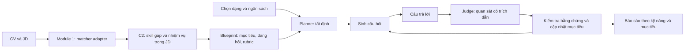

# Phỏng vấn theo bằng chứng — V2

Phạm vi: phân tích yêu cầu, lập kế hoạch, phỏng vấn thích nghi và báo cáo. Không triển khai module ôn luyện, ghi chú hoặc SBERT/GNN thật.

## Pipeline và trách nhiệm

- `matching_cv` chạy Module 1 và tạo trực tiếp `Module1Output` với `w_j` và `soft_match`. Router ghi `matcher_source: MATCHING_CV` ở output `/api/v1/match`. Kết quả C2 không còn trả `flags` hoặc `matcher_source` trong public output.
- `skill_gap`: bổ sung `job_tasks`, trích dẫn JD, lý do mức yêu cầu, trọng số quan trọng, độ bao phủ bằng chứng CV, cờ recency/degraded. Giữ công thức gap và priority hiện có. Thứ tự suy luận mức yêu cầu: nhiệm vụ/độ sâu rõ ràng → kinh nghiệm riêng của kỹ năng → seniority fallback. Optional không đồng nghĩa mức thấp.
- `evidence/provider.py`: interface LLM cho blueprint, question, judge. Không tải compiled artifact C3 cũ. Câu hỏi, rubric và kết luận của LLM đều phải qua kiểm tra trước khi lưu.
- `planning.py` tạo một mục tiêu cho mỗi nhiệm vụ với ID ổn định. Kỹ năng có `importance_weight` đạt ngưỡng `core_importance` được xếp vào nhóm cốt lõi. Ngưỡng mặc định là 0,7. Bộ lập kế hoạch ưu tiên nhóm cốt lõi và xếp theo `priority` từ Mô-đun 2 giảm dần trong mỗi nhóm. Khi điểm bằng nhau, bộ lập kế hoạch xét trọng số, kết quả phỏng vấn trước, thời lượng ước tính và ID mục tiêu. Trong mỗi nhóm, kế hoạch dành lượt đầu cho các kỹ năng phù hợp với hình thức và thời lượng của phiên trước khi hỏi thêm nhiệm vụ của cùng kỹ năng. Bộ điều phối có thể đưa mục tiêu chưa hỏi trở lại khi còn ngân sách.
- Với phiên mới, backend xác minh trích dẫn trong CV và JD trước khi gửi `verification_sources` vào `/start`. Bước chuẩn bị của AI lưu một chi tiết cần làm rõ theo `criterion_id` trong `snapshot.verification` nếu có đoạn CV phù hợp. Câu đầu nêu liên hệ ngắn với yêu cầu JD đã xác minh và kinh nghiệm trong CV khi có chi tiết cần làm rõ. Bộ duyệt kiểm tra liên hệ này trong lời hỏi hiển thị cho ứng viên. Câu làm rõ bám bằng chứng trong câu trả lời. Khi thiếu ngữ cảnh CV, câu hỏi dùng tình huống JD. [Ca đối chứng giả lập](../artifacts/module-3-cv-verification/report.md)
- `assessment.py`: kiểm tra trích dẫn nguyên văn, criterion IDs và tính hợp lệ của judgment; tổng hợp bằng chứng; quyết định clarification/follow-up/easier/deeper/contradiction verification. Kết luận dựa trên bằng chứng và độ sâu theo Criteria.
- `workflow.py`: chuyển trạng thái trên bản sao sâu. Lỗi judge/generator không làm thay đổi snapshot đã lưu. Giới hạn thời gian, tổng số câu và số câu/mục tiêu; dành cơ hội ban đầu cho các mục tiêu còn lại.
- `reporting.py`: projection thuần từ snapshot. Kết luận theo mục tiêu, nhóm theo kỹ năng trên UI; mỗi bằng chứng có `turn_id` và trích dẫn câu trả lời.

## Dạng phỏng vấn

`MIXED` cho phép các dạng phù hợp với nhiệm vụ. `FOCUSED` chỉ chọn mục tiêu hỗ trợ dạng người dùng chọn. Các dạng: `CODING`, `DEBUGGING`, `DESIGN` (architecture/system design), `TECHNICAL_EXPLANATION`, `BEHAVIORAL`.

Một mục tiêu có nhiều `suitable_modes` cùng lý do và coverage theo criterion. MIXED chọn theo task fit → coverage essential criteria → dạng ít được dùng hơn → thứ tự blueprint khi hòa. FOCUSED giữ đúng lựa chọn người dùng. Mode được khóa trong từng objective. Không có mục tiêu phù hợp thì trả lỗi rõ ràng để người dùng đổi dạng.

Độ sâu câu hỏi có thang riêng: L1 Foundation, L2 Application, L3 Analysis/Problem Solving, L4 Design/Trade-offs. `required_proficiency` vẫn là thang C2 1–5. `target_depth` được khóa theo nhiệm vụ. `Turn.question_depth` lưu độ sâu của câu thực sự đã hỏi. Câu đầu ở target, câu chẩn đoán thấp hơn một mức, câu mở rộng chỉ dùng khi có `extension_depth`, anchor cao hơn và cấu hình cho phép. Không yêu cầu đi qua từng mức. Chi tiết audit, thuật toán, cấu hình và ví dụ phiên đầy đủ ở [evidence-interview-v2-audit.md](evidence-interview-v2-audit.md).

LLM trả `BlueprintDraft` với cấu trúc rubric, độ sâu đề xuất và dạng hỏi phù hợp. Mỗi `requirement_id` trong bản nháp khớp với một key trong `requirements`. Builder kiểm tra ID và kỹ năng, lấy metadata JD từ đầu vào và gán ID mục tiêu, ID tiêu chí trước khi lưu `Blueprint`. Lượt sau có thể tái sử dụng blueprint đã lưu.

## Ý nghĩa kết luận

| Trạng thái | Ý nghĩa |
|---|---|
| `NOT_ASSESSED` | Chưa đánh giá câu trả lời nào cho mục tiêu |
| `INSUFFICIENT_EVIDENCE` | Thiếu tiêu chí thiết yếu hoặc còn bằng chứng mâu thuẫn |
| `NOT_DEMONSTRATED` | Mọi tiêu chí thiết yếu có thất bại được đối chiếu qua các ngữ cảnh độc lập và chẩn đoán; chưa có thể hiện thành công ở target hoặc thấp hơn. Không yêu cầu ứng viên phải nói “không biết”, không khẳng định họ thiếu toàn bộ kỹ năng |
| `DEMONSTRATED_BELOW_TARGET` | Các tiêu chí thiết yếu được quan sát đủ; thất bại ở target có bằng chứng chẩn đoán đối chiếu. Một câu sai đơn lẻ vẫn là thiếu bằng chứng |
| `DEMONSTRATED_AT_TARGET` | Đủ bằng chứng thiết yếu, đáp ứng mức yêu cầu |
| `DEMONSTRATED_ABOVE_TARGET` | Đã đạt target và đáp ứng anchor cao hơn được định nghĩa từ blueprint tại extension depth; trả lời dài hoặc tốt ở target chưa đủ |

Câu trả lời ngắn không tự động bị hạ điểm. Evidence ledger giữ cả thuận/nghịch, độ sâu, assistance và ngữ cảnh; evidence dễ hơn hoặc có HINT không xác nhận target. Hint trong feedback cũng được theo dõi cho lượt sau. Mâu thuẫn chỉ được xóa qua `VERIFY_CONTRADICTION` có bằng chứng giải quyết. Hết lượt/thời gian là lý do dừng, không phải điều kiện chứng minh năng lực. Sai câu mở rộng không xóa bằng chứng đã đạt target.

## Hỏi từng tiêu chí và đào sâu thích nghi

Một kỹ năng có thể có nhiều mục tiêu theo nhiệm vụ JD; mỗi mục tiêu có nhiều tiêu chí. Mỗi lượt mới chỉ nhắm đúng **một** tiêu chí, do bộ điều phối chọn trước khi gọi LLM. Generator dùng tiêu chí, hành động và lịch sử liên quan để hỏi một hành vi quan sát được. Khi làm rõ, câu hỏi giữ nguyên tình huống. Khi hạ độ khó, câu hỏi tập trung vào một quyết định nền tảng nhỏ hơn. Validator kiểm tra mode, độ sâu, criterion ID, phạm vi tình huống và một số dạng câu hỏi gộp. Lời nhận xét có thể để trống để chuyển thẳng đến câu hỏi tiếp theo.

Validator bỏ qua dấu hỏi trong URL và literal được trích dẫn không có khoảng trắng; danh sách điều kiện đầu vào dạng “Nếu chuỗi rỗng, trả về False” không tự bị coi là nhiều yêu cầu trả lời. Khi sinh câu hỏi không hợp lệ, mỗi retry nhận `required_question_contract` với metadata chính xác và `validation_error` chỉ rõ điều kiện sai (mode, depth, tiêu chí, scope, câu gộp hoặc lặp). Log ghi lý do từng lần, không ghi câu trả lời hoặc toàn bộ câu hỏi. Không tự đổi nhãn mode/depth/criterion của đầu ra sai để vượt kiểm tra.

`required_question_contract` cung cấp mode, độ sâu, ID tiêu chí và scope bắt buộc khi làm rõ. Judge nhận rubric của tiêu chí hiện tại trong `objective.criteria`, ID cần chấm trong `turn.question.criterion_ids` và lời đáp gốc kèm số dòng để trích bằng chứng.

Generator trả mode và độ sâu để validator đối chiếu bản nháp với hợp đồng. Trong snapshot, `Turn.mode` và `Turn.question_depth` là nguồn metadata của lượt. `Turn.question` lưu nội dung, ID tiêu chí, mức hỗ trợ và phạm vi tình huống. Snapshot cũ thiếu độ sâu cấp lượt có thể lấy giá trị từ `question.depth` khi đọc.

Hết retry là `QuestionUnavailableError` → HTTP 503 với thông báo tiếng Việt, không còn trả lỗi yêu cầu 422 hoặc chuỗi kỹ thuật `Question generation failed validation after bounded retry` cho ứng viên. Snapshot đầu vào và dữ liệu đã lưu giữ nguyên; UI giữ bản nháp/request ID để gửi lại. Ngày 08/11/2026 đã kiểm chứng 260 kiểm thử Python, bao gồm lỗi tạo câu tiếp theo, gửi lại không đếm trùng, scope clarification và dữ liệu chứa dấu hỏi/danh sách điều kiện. Log của lần lỗi cũ chỉ có HTTP 422 nên chưa xác định được ràng buộc cụ thể đã bị vi phạm trong lần đó.

`criterion_progress` lưu riêng số lượt, clarification/easier/extension, các phần chưa xác minh, số lượt không tiến triển, những case đã quan sát và lý do dừng. Cờ tổng ở objective được giữ cho tương thích/telemetry, không còn tiêu hao cơ hội hỏi làm rõ hoặc chẩn đoán của tiêu chí khác. Snapshot cũ thiếu counters được khôi phục từ các lượt đã lưu khi tiếp tục trả lời.

Context sinh câu hỏi chỉ gửi lịch sử hỏi–đáp đầy đủ của cùng mục tiêu và tiêu chí đang hỏi, bao gồm câu chính, các lượt làm rõ/đào sâu và các lượt trước khi tạm chuyển sang mục tiêu khác. Bằng chứng trước đó cũng được lọc theo tiêu chí hiện tại để giữ thông tin kiểm chứng mâu thuẫn. Các lượt thuộc mục tiêu khác bị loại hoàn toàn khỏi context sinh câu hỏi. Các lượt cùng mục tiêu nhưng khác tiêu chí chỉ xuất hiện trong `other_questions`, mỗi mục gồm tối đa 300 ký tự đầu của câu hỏi và cờ `truncated`, không có câu trả lời hay kết quả chấm; LLM chỉ dùng chúng để tránh hỏi lặp. Kiểm tra trùng nguyên câu phía server vẫn đối chiếu toàn bộ lịch sử gốc. Database/snapshot giữ nguyên toàn bộ lịch sử, và context chấm câu trả lời vẫn giữ phạm vi cùng mục tiêu như trước. Thay đổi này giảm dữ liệu đưa vào bộ sinh câu hỏi; chưa có đo đạc độ trễ hoặc benchmark chất lượng bằng LLM thật.

Kiểm chứng ngày 17/11/2026: 95 kiểm thử offline đạt, gồm `test_question_context_scope.py`, `test_evidence_workflow.py` và `test_evidence_depth_policy.py` với `-k 'not api'`, cùng `test_dspy_optimization.py`. Sáu ca mới phủ TEXT/VOICE, đổi mục tiêu/tiêu chí, hỏi phụ, tiếp tục nhánh sau khi chuyển mục tiêu, bằng chứng mâu thuẫn, chống lặp toàn phiên và giữ nguyên transcript. Đã tái sinh artifacts DSPy bằng labeled few-shot, không gọi model. Bộ HTTP/voice đầy đủ chưa xác nhận: quá trình chạy bị treo tại FastAPI TestClient trên môi trường Windows và đã được dừng.

Sau mỗi câu trả lời: ưu tiên giải quyết mâu thuẫn, quay về target sau chẩn đoán thành công, chuyển tiêu chí khi đã đủ bằng chứng, hoặc hỏi tiếp đúng phần chưa rõ. Judge trả `unresolved_aspects` cho bằng chứng chưa đầy đủ; không được vừa đánh dấu đạt anchor vừa khai báo phần bắt buộc còn thiếu. Một follow-up không mặc định tăng độ khó. Extension chỉ bật bằng policy, với anchor cao hơn đã khóa; từng tiêu chí được hỏi riêng.

Trích dẫn bằng chứng phải là một đoạn liên tục trong câu trả lời hiện tại. Validator cho phép đối chiếu khác biệt khoảng trắng và Unicode NFC/NFD, rồi lưu lại đúng đoạn nguyên văn từ bản gốc. Không bỏ dấu, đổi hoa/thường, sửa từ, thêm dấu câu hoặc nối các đoạn rời. Kết quả sai được gửi lại cho Judge cùng lỗi cụ thể để sửa trong giới hạn retry; nếu vẫn không có trích dẫn hợp lệ thì trả 503, giữ nguyên trạng thái và không gán điểm cho ứng viên.

Với mã nguồn hoặc câu trả lời nhiều dòng, Judge nhận `answer_lines` có số dòng từ 1 và có thể chọn `response_line_range=[start,end]` liên tục, bao gồm cả hai đầu. Server lấy nguyên văn các dòng từ câu trả lời gốc, giữ cả xuống dòng và ký tự HTML/JavaScript, thay vì để AI viết lại code trong trích dẫn. Khoảng dòng ngoài giới hạn hoặc chỉ chứa khoảng trắng bị từ chối; cách trích dẫn bằng chuỗi nguyên văn vẫn tương thích với dữ liệu cũ. Nhận xét quá 300 ký tự được thay bằng lời xác nhận trung tính sẵn có; lỗi trình bày này không hủy bằng chứng hợp lệ hoặc yêu cầu chấm lại. Kiểm thử hồi quy bao gồm To-Do List, trích dẫn nối đoạn sai, khôi phục theo dòng và giữ nguyên snapshot khi bằng chứng không hợp lệ.

Các mặc định là heuristic vận hành, chưa được hiệu chuẩn trên người dùng:

| Giới hạn | Mặc định | Ý nghĩa |
|---|---|---|
| `CRITERION_SOFT_LIMIT` (nội bộ) | 3 | Mốc xem xét tiến triển và nhường lượt cho tiêu chí/kỹ năng chưa được phủ; không tự đóng tiêu chí |
| `MAX_STAGNANT_TURNS` (nội bộ) | 2 | Từ mốc mềm, dừng tiêu chí nếu không có bằng chứng thực chất ở case mới hoặc thay đổi phần chưa rõ trong số lượt liên tiếp này |
| `MAX_TURNS_PER_CRITERION` (nội bộ) | 6 | Giới hạn cứng cho một tiêu chí, gồm cả làm rõ/chẩn đoán/mở rộng |
| `max_questions_per_objective` (config) | 8 | Giới hạn cứng cả mục tiêu; cho phép cấu hình 1–40, vẫn chịu ngân sách toàn phiên |
| `max_questions` / `duration_seconds` | 10 / 900 | Giới hạn cứng toàn phiên |

Phần chưa rõ thay đổi được nhận biết bằng danh sách đã chuẩn hóa, không dùng điểm confidence chưa hiệu chuẩn. Thay đổi cách mô tả gap vẫn có thể bị coi là tiến triển; giới hạn cứng ngăn chuỗi hỏi kéo dài. Case giống nhau ở cùng độ sâu không được tính lại là case mới. Các ngưỡng đánh giá và phân bổ cốt lõi (`fallback_depth`, `core_importance`, `reserve_followup_fraction`, `min_failure_contexts`, `allow_extension_probes`) có thể cấu hình qua `EVIDENCE_POLICY_JSON` trên AI service và được giữ trong snapshot.

Nếu còn mục tiêu khác, hệ thống nhường cơ hội ban đầu trước khi dùng hết ngân sách và luân chuyển sau mốc mềm, giữ nguyên bằng chứng/counters để quay lại. Trong mục tiêu, ưu tiên tiêu chí thiết yếu chưa hỏi sau mốc mềm trước khi tiếp tục đào sâu tiêu chí cũ. Dừng vì `NO_PROGRESS`, `CRITERION_BUDGET`, thời gian hoặc số câu không tự sinh kết luận yếu: phần chưa xác minh vẫn là chưa đủ bằng chứng. Báo cáo gồm `objectives[].criteria` với `criterion_id`, `description`, `essential` và `assessment`; rubric/anchor và telemetry nội bộ không được đưa vào public report hoặc `pending_turn`.

Config đã lưu, kể cả giới hạn 3 lượt của phiên cũ, được giữ nguyên. Để dùng mặc định 8 lượt/mục tiêu, bắt đầu phiên mới. Không sửa DB hoặc tự tăng ngân sách phiên đang chạy.

## Nhận xét ngắn và chuyển tiếp hội thoại

Sau khi chấm câu trả lời, Judge tạo một câu nhận xét tiếng Việt, tối đa 300 ký tự, dựa trên ý ứng viên thực sự đã nêu hoặc phần diễn đạt chưa rõ. Không khen chung chung, công bố điểm/kết luận đạt-trượt, tiết lộ rubric, hướng dẫn đáp án hay hỏi thêm trong phần nhận xét. Nếu phản hồi quá dài, dùng cơ chế retry judgment hiện có; không tính thành lượt phỏng vấn mới.

Sau khi bộ điều phối chọn câu hỏi tiếp theo, `conversation.py` ghép nhận xét với một lời dẫn phù hợp: làm rõ, kiểm chứng, chẩn đoán, mở rộng, chuyển khía cạnh hoặc chuyển kỹ năng. Phần này được lưu riêng ở `Turn.introduction` và public `pending_turn.introduction`; `question` vẫn chỉ là nhiệm vụ cần trả lời. Trình tự là **nhận xét → lời chuyển tiếp → một câu hỏi mới**. Câu đầu không có nhận xét về câu trả lời chưa tồn tại. Phản hồi bị đánh dấu chứa gợi ý được thay bằng lời ghi nhận trung tính ở public feedback và introduction.

TEXT hiển thị phần này trực tiếp trước câu hỏi, không yêu cầu mở mục thu gọn. VOICE đọc introduction và câu hỏi trong cùng một yêu cầu TTS; backend chỉ lấy nội dung đã lưu sau khi kiểm tra chủ phiên, turn/version và thời hạn. Không thêm lượt hỏi, không gọi thêm LLM để tạo lời dẫn. Reload giữ nguyên introduction; snapshot cũ thiếu trường này vẫn đọc được với mặc định rỗng.

Kiểm chứng phần hội thoại ngày 08/11/2026: 251 kiểm thử Python, 12 kiểm thử backend (voice/contract/AI client), TypeScript, ESLint và production build đạt. Browser fixtures xác minh phản hồi hiển thị trước câu hỏi qua 15 lượt, giữ sau reload, bố cục desktop/mobile và hồi quy luồng voice với cùng số yêu cầu TTS. Chưa chạy nhận xét hoặc phát âm bằng LLM/TTS thật trong đợt này.

Báo cáo mới mô tả kết quả theo mục tiêu và tiêu chí. Mỗi bằng chứng mang `turn_id` để nối với câu hỏi. Các mục tiêu ngoài dạng hoặc ngân sách xuất hiện với lý do loại trừ. Giao diện cũng đọc được các báo cáo cũ có `evidence_turn_ids`.

## API, lưu trữ và đồng thời

Public backend: `/api/v2/sessions/{sessionId}/interview`.

| API | Đầu vào |
|---|---|
| `GET /` | Khôi phục public state từ DB |
| `POST /start` | `interaction_mode`, `focused_question_mode`, `duration_seconds`, `max_questions` và `max_questions_per_objective` tùy chọn |
| `POST /respond` | request_id UUID, turn_id, expected_state_version, candidate_response |
| `POST /stop` | request_id UUID, expected_state_version |
| `GET /report` | Báo cáo từ cùng snapshot |

Backend kiểm tra chủ sở hữu trước khi trả state hoặc receipt. Frontend gửi qua service `evidenceInterview` và axiosClient theo cấu hình kết nối backend hiện tại; component không gọi HTTP trực tiếp.

Server suy ra `MIXED` khi `focused_question_mode` là `null` hoặc bị bỏ qua, và `FOCUSED` khi có dạng câu hỏi cụ thể. Client cũ vẫn có thể gửi `mode` nếu khớp với quy tắc này. Khi bỏ qua `max_questions_per_objective`, Backend áp dụng mặc định 8. Snapshot và response có cả `mode` đã suy ra và giới hạn thực tế của phiên.

Khi trang phỏng vấn đang mở, bộ đếm kiểm tra `deadline_at` mỗi giây và khi tab nhận focus/đổi trạng thái hiển thị. Hết hạn tự gọi `/stop`, kể cả sau lỗi chấm AI; không tự nộp bản nháp. Nếu đang gửi câu trả lời, chờ yêu cầu đó hoàn tất rồi kiểm tra lại hạn. Lỗi kết thúc tạm thời được thử lại cách nhau ít nhất 5 giây với cùng request ID; HTTP 409 tải lại state trước khi thử với version mới. Trang kết quả chỉ đọc không gửi lệnh kết thúc. Đây là bộ đếm phía trình duyệt; khi đóng trang hoàn toàn, backend kiểm tra hạn ở yêu cầu tiếp theo. `web-app/scripts/interview-expiry-smoke.mjs` kiểm thử 7 tình huống bằng API fixtures: idle, lỗi chấm, lỗi stop, xung đột version, yêu cầu đang chạy, voice và chỉ đọc.

Migration `V2__evidence_interviews.sql` thêm:

- `interview_runs`: một snapshot có version, config và public projection cho mỗi session.
- `interview_commands`: receipt theo `(session_id, request_id)` kèm hash payload, bảo đảm retry không ghi trùng.
- `session_turns.external_turn_id`: khóa duy nhất để projection transcript không tạo lượt trùng.

Khi gọi `/api/v2/interview/start`, Backend gửi `session_id`, `skills` đã lọc, `config` và `opening` gồm `company`, `role_title`, `candidate_name`, tóm tắt JD/CV giới hạn độ dài và `attempt_number` (nếu có). AI service mặc định `interviewer_name` là `Minh`, nạp `InterviewPolicy` thu gọn (5 ngưỡng cốt lõi) từ `EVIDENCE_POLICY_JSON` hoặc mặc định rồi lưu vào `snapshot.policy`. Khi hồ sơ đã có rubric, Backend gửi thêm `blueprint` đã lưu của hồ sơ (không cần gửi `policy`).

Backend gửi snapshot đã lưu vào các yêu cầu chuyển tiếp. Các endpoint nội bộ `/api/v2/interview/start`, `/respond`, `/conversation` và `/stop` trả `snapshot` và `public`. Các endpoint AI này cần nằm trong mạng backend khi triển khai.

`interview_runs` lưu snapshot và projection phục vụ ứng dụng. Hai cột bổ sung của migration V6 (`blueprint_json` và `dynamic_state_json`) vẫn có trong DB để giữ tương thích dữ liệu đã lưu. Rubric dùng chung giữa các lượt được lưu tại `application_profiles.blueprint_json`. Quyền hỏi lại, hỏi dễ hơn hoặc hỏi sâu hơn được theo dõi theo từng tiêu chí trong `criterion_progress`.

Gọi LLM diễn ra ngoài transaction DB. Khi commit, khóa hàng session, kiểm tra version, ghi snapshot + transcript + trạng thái session + receipt trong một transaction. Nếu hai yêu cầu khác nhau cùng version đến đồng thời, chỉ một yêu cầu commit; yêu cầu còn lại nhận 409. Nếu receipt đã tồn tại với cùng hash, trả lại response đã lưu. Tái sử dụng request ID với payload khác trả 409.

Trong lúc hệ thống còn dùng Jackson 2 để lưu JSON và Spring Boot 4/Jackson 3 ở HTTP, V2 truyền JSON đã serialize với content type `application/json` tại biên HTTP để tránh JsonNode bị serialize thành metadata của Java object. Có kiểm thử qua HTTP converter thật.

## Tương thích và triển khai

- Flyway tự áp dụng V2 khi backend khởi động; không sửa V1, không chạy migration vào DB đang dùng trong các script kiểm thử.
- Engine C3 cũ đã được gỡ. Endpoint thực thi cũ trả HTTP 410, UI chỉ cho xem lại lịch sử/kết quả đã lưu. Phiên đã có transcript hoặc AI session ID cũ không được đổi engine tại chỗ; clone hoặc tạo lượt mới để dùng V2.
- Phiên V2 đã bắt đầu khóa config/blueprint. Các API ghi transcript/trạng thái cũ bị chặn đối với V2. Feedback người dùng vẫn dùng cơ chế hiện có (giao diện và evaluation HR đã được gỡ bỏ ở V11).
- Cache C2 cũ thiếu contract nhiệm vụ được phân tích lại trước khi bắt đầu V2 từ CV/JD gốc. Không phân tích lại trong mỗi lượt trả lời. Snapshot giữ dữ liệu C2 và rubric cho phiên đang chạy.
- Snapshot giữ `schema_version=2`. Các field cũ (`belief`, `raw_belief`, `tag`, `engine_version`, `rubric_version`, `question.assistance`, `objective.inferred`, `objective.extension_criterion_ids`, `objective_state.clarification_spent`, `conversation.introduction_skipped`) đã bị loại bỏ khỏi schema và bị từ chối khi xác thực (`extra="forbid"`). Không cần migration phá hủy dữ liệu hoặc tính lại báo cáo cũ.
- Để chạy LLM thật cần `OPENROUTER_API_KEY` và `OPENROUTER_MODEL` trên AI service. Câu coding hiện được đánh giá theo code/lập luận người dùng nhập; chưa có sandbox thực thi code.

## Kiểm chứng và giới hạn nghiên cứu

Ngày 09/11/2026: loại bỏ phân phối niềm tin khỏi luồng V2, gồm schema Judge, prompt, khởi tạo từ CV, cập nhật simplex, metamorphic tag và phép tính TV. Gỡ engine và UI thực thi cũ sử dụng cơ chế đó. Dataset/bộ tối ưu DSPy được khôi phục sau khi gỡ quá rộng: giữ đủ 20 mẫu hỏi, 20 câu trả lời gốc và split train/dev 14/6; chuyển nhãn sang Criteria/bằng chứng, cập nhật metric, compile và regenerate artifacts theo schema V2. Source questions/answers và provenance nằm trong `optimization/examples.json`, không đưa metadata nguồn vào output demos. Provider chỉ load artifacts khi truyền `compiled_dir` rõ ràng, có kiểm tra manifest và fingerprint schema; không tự kích hoạt demos mới cho phiên đang chạy. Xem [hướng dẫn DSPy](../ai-service/adaptive_questioning/optimization/README.md). Module skill gap không tính phân phối này; giữ nguyên điểm CV/JD, confidence trích xuất, độ thiếu hụt và priority tất định. Các bài kiểm thử toán học/engine cũ được gỡ theo phần thực thi đã loại bỏ; bổ sung kiểm thử hợp đồng không có xác suất, đọc snapshot cũ và ngăn gọi engine đã ngừng hỗ trợ. Báo cáo audit ngày 07/11 là tài liệu lịch sử, không mô tả contract hiện tại.

Kiểm chứng đợt loại bỏ: 238 kiểm thử Python (skill gap, phỏng vấn, voice), 64 kiểm thử backend trên PostgreSQL tạm, TypeScript, ESLint các file thay đổi và production build Docker của cả ba dịch vụ đều đạt. Browser smoke xác nhận luồng TEXT qua 15 lượt/reload/mobile và phiên cũ chỉ xem lại, không gửi yêu cầu thực thi. Đã cập nhật dịch vụ cục bộ và xác nhận schema AI đang chạy không còn các field đã loại bỏ. Không gọi LLM thật trong đợt kiểm chứng này.

Kiểm chứng sau khi khôi phục DSPy: 273 kiểm thử Python đạt, gồm 28 kiểm thử optimization. Có kiểm tra digest của toàn bộ câu hỏi/câu trả lời gốc, split train/dev, validator runtime, metric, compile/save/load, gọi provider V2 bằng DummyLM và artifact tương đương LF/CRLF. Đã tái sinh artifact theo contract mới nhất (bao gồm response_line_range), cập nhật riêng AI service và kiểm tra load artifact/health thành công. Bootstrap với LLM thật chưa được chạy; demos vẫn là tùy chọn rõ ràng qua compiled_dir.

Generator hỏi ngắn, tập trung đúng một nhiệm vụ của tiêu chí đang đánh giá. Phần lời dẫn TEXT thường 1–3 câu, tối đa khoảng 80 từ; code, bảng và log cần thiết được đặt riêng, không cắt dữ kiện để rút ngắn đề. VOICE hướng tới 30–55 đơn vị tách bằng khoảng trắng (tính cả bối cảnh), tối đa 90; vượt giới hạn sẽ được yêu cầu sinh lại qua cơ chế retry hiện có, không cắt chuỗi. Đây là cách đếm kỹ thuật, không phải bộ tách từ tiếng Việt. Câu hỏi giữ nguyên độ sâu và dữ kiện cần thiết, không đọc rubric hoặc gộp nhiều yêu cầu vào một câu. Lượt hỏi tiếp tập trung vào khía cạnh chưa có bằng chứng; khi sắp hết lượt, ưu tiên một nhiệm vụ có giá trị phân biệt cao, không dồn các câu hỏi còn lại. Cơ chế đánh giá bằng chứng và ngân sách lượt giữ nguyên.

Chạy từ `ai-service`: `python -m pytest tests_skill_gap tests_adaptive_questioning -q`.

Trên Windows với Docker: `scripts/verify-evidence-migration.ps1` kiểm tra V1 → V2, dữ liệu legacy và unique/cascade constraints trên PostgreSQL 17 tạm. `scripts/verify-evidence-backend.ps1 -JavaHome <JDK>` chạy toàn bộ kiểm thử backend trên DB tạm; cấu hình UTC chỉ cho JVM kiểm thử để tránh alias timezone cũ của host. Container kiểm thử được xóa trong `finally`.

Frontend: `npm run build`; sau khi mở bản build trên localhost, chạy `node scripts/evidence-smoke.mjs http://localhost:3217` trong `web-app`. Browser test dùng API fixtures, kiểm tra chọn dạng, bắt đầu, reload, giữ câu trả lời/request ID sau lỗi mạng, và đọc báo cáo.

Lần triển khai đầu ngày 07/11/2026 đã xác minh 159 kiểm thử Python, 18 kiểm thử backend, migration PostgreSQL 17, production build frontend, ESLint các file V2 và browser smoke test. Kết quả chạy lại sau audit được ghi riêng trong [báo cáo audit](evidence-interview-v2-audit.md). Chưa chạy end-to-end với LLM thật hoặc đánh giá chất lượng trên người dùng thật.

Các kiểm thử phần mềm không xác nhận độ chính xác đánh giá năng lực của LLM. Để đánh giá nghiên cứu: cố định model, rubric/signature version, matcher thật/mock và reference_date; dùng cùng CV/JD/câu trả lời và cùng ngân sách giữa C3 baseline và V2. Tách train/dev/test; người đánh giá độc lập kiểm tra độ phù hợp dạng câu hỏi, grounding, agreement của kết luận, coverage và chi phí/số lượt. Báo riêng trường hợp intern/fresher, kỹ năng không ghi trong CV, kỹ năng đã match, câu trả lời ngắn đúng và mâu thuẫn. Chưa có kết quả hiệu chuẩn hoặc benchmark người thật trong thay đổi này.

Đợt điều phối theo tiêu chí ngày 08/11/2026 đã kiểm chứng 243 kiểm thử Python (adaptive questioning, skill gap, voice), 3 kiểm thử hợp đồng backend, TypeScript, ESLint các file frontend thay đổi, production build và browser smoke với API fixtures. Ca hồi quy phủ tiêu chí cần 4 lượt, giới hạn 6 lượt, dừng không tiến triển, nhường/quay lại kỹ năng, khôi phục counters phiên cũ và extension riêng từng tiêu chí. Chưa chạy phỏng vấn với LLM thật trong đợt thay đổi này.
