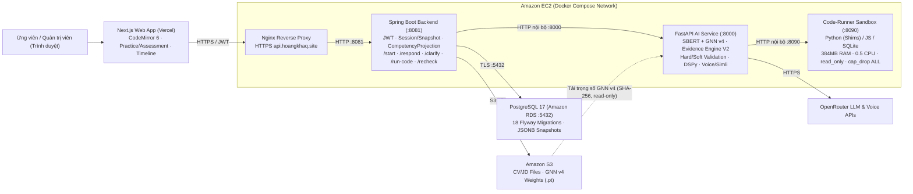

# Cập nhật Kiến trúc và Nâng cấp Hệ thống cho Khóa luận Tốt nghiệp (Smile Interview)

Tài liệu này bổ sung cho mục **3.3.3. Kiến trúc của hệ thống** và **Chương 4. Thiết kế và Cài đặt** trong Khóa luận Tốt nghiệp (FIT-IUH), phản ánh quá trình chuyển đổi Smile Interview từ phiên bản Nghiên cứu Khoa học (NCKH) sang hệ thống luyện phỏng vấn định hướng sản phẩm hoàn chỉnh.

---

## 1. Bảng so sánh nâng cấp: Từ NCKH sang Khóa luận Tốt nghiệp

| Trụ cột nâng cấp | Phiên bản NCKH (Trước) | Phiên bản KLTN (Sau nâng cấp) | Giá trị đối với ứng viên & Hội đồng |
| :--- | :--- | :--- | :--- |
| **1. Độ ổn định sinh câu hỏi (P0)** | Ràng buộc validation gộp chung; câu hỏi sinh ra dễ bị từ chối thành lỗi `503` khi LLM dài hoặc lệch nhẹ ở nhánh `ASK_EASIER`/`CLARIFY` (benchmark ban đầu 58/100). | Phân tầng lỗi **Hard** (chặn sai hợp đồng/nghiêm trọng) và **Soft** (lỗi văn phong/độ dài/khớp ý mềm); có cơ chế **Safe Soft Fallback** (tối đa 2 lần sửa cho lượt chẩn đoán) + telemetry độ trễ từng chặng (`gen_seconds`, `review_seconds`) + cấu hình `OPENROUTER_JUDGE_REASONING_EFFORT`. | Giảm triệt để lỗi gián đoạn phiên `503`, đảm bảo demo trực tiếp trước Hội đồng ổn định và đo lường được độ trễ từng tầng. |
| **2. Trải nghiệm Phỏng vấn Coding thực thụ (P1.1)** | Ô `<textarea>` thuần; kiểm tra code mẫu bị hardcode cho một bài toán đơn lẻ (`deduplicate_events`). | Trình soạn thảo **CodeMirror 6** (`<InterviewCodeEditor />`) hỗ trợ tô sáng cú pháp Python / JavaScript / SQL trong cả phòng **Text** và **Voice**; tách dịch vụ thực thi cô lập **`code-runner`** (`:8090`, RAM ≤ 384 MB, `read_only`, `cap_drop: ALL`, tích hợp bộ thư viện chọn lọc & giả lập dịch vụ trong RAM `redis -> fakeredis`, `pymongo -> mongomock`) với chuẩn trừu tượng `CodeExecutionProvider`, API chạy thử **`POST /run-code`** (chỉ chạy `sample_tests`, ẩn `hidden_tests` khi gửi về client) và phòng vệ chống chấm trượt oan khi thiếu package ngoài. | Ứng viên viết, chạy thử code (kể cả Redis/MongoDB in-memory) ngay trong phòng phỏng vấn; hệ thống chấm dựa trên kết quả chạy `hidden_tests` thực tế và tự chuyển sang chấm ngữ nghĩa khi gặp thư viện ngoài sandbox. |
| **3. Tách biệt Luyện tập & Đánh giá + Hỏi làm rõ (P1.2)** | Chỉ có một chế độ đánh giá; không thể hỏi làm rõ đề bài (`clarifying questions`) hay xin gợi ý; thiếu câu hỏi hành vi STAR khi JD ít kỹ năng mềm; thiếu đáp án mẫu. | Hỗ trợ 2 mục đích phiên: **Luyện tập (`PRACTICE`)** (cô lập khỏi `CompetencyProjection`, bật nút *Xin gợi ý nhỏ* và tùy chọn *Ôn tổng duyệt cả kỹ năng đã đạt*) và **Đánh giá (`ASSESSMENT`)**. Bổ sung endpoint **`POST /clarify`** (tối đa 2 lượt hỏi làm rõ đề bài + 1 gợi ý ở Practice mà **không trừ** `max_questions`), tự sinh mục tiêu **STAR Behavioral** khi chọn chế độ Hành vi, cho phép chuyển mode linh hoạt ở `MIXED`, bổ sung **`reference_answer`**, **`delivery_notes`** (STAR/Design/Voice) và **`introduction_feedback`**. | Tái hiện đúng bối cảnh phỏng vấn thật (ứng viên được hỏi làm rõ yêu cầu biên), giảm tâm lý sợ rớt điểm khi ôn luyện và cung cấp phản hồi thực chất để tự sửa. |
| **4. Chấm điểm sẵn sàng có trọng số & Tiến bộ đa phiên (P1.3)** | Tỉ lệ đạt cộng đều mọi kỹ năng (dễ gây ảo tưởng khi trượt kỹ năng cốt lõi); chưa có biểu đồ theo dõi tiến bộ qua nhiều lượt. | Tính **Mức độ sẵn sàng có trọng số Core** (`is_core` trọng số **2×** so với kỹ năng bổ trợ **1×**); hiển thị nhãn **`Cốt lõi`** và cấp độ sâu **`L1–L4`** trên từng mục tiêu; thống nhất chỉ đếm tiêu chí `essential` trên thẻ kỹ năng; bổ sung **`timeline`** trên `CompetencyProjection` và biểu đồ SVG **`<CompetencyProgressTimeline />`** + bộ đếm phiên luyện tập riêng biệt. | Phản ánh trung thực độ sẵn sàng tuyển dụng và minh họa rõ vòng khép kín **Đánh giá → Kế hoạch ôn tập → Kiểm chứng lại (Recheck) → Tiến bộ**. |
| **5. Vòng lặp khép kín Kế hoạch ôn tập & Kiểm chứng** | Kết quả phỏng vấn tách rời khỏi tiến độ ôn tập. | Gắn chặt từng đầu việc checklist với tiêu chí còn yếu, hỗ trợ **Kiểm chứng lại mục tiêu (`Recheck`)** trên cả Văn bản, Giọng nói và Giọng nói kèm Code, so sánh trực tiếp bằng chứng **Trước / Sau khi ôn**. | Khép kín hành trình học tập cho sinh viên từ lúc phân tích CV–JD đến khi đạt mục tiêu ứng tuyển. |

---

## 2. Sơ đồ kiến trúc triển khai cập nhật (Bổ sung mục 3.3.3.3)

So với phiên bản NCKH gồm 3 container trên máy chủ Amazon EC2 (Nginx, Spring Boot, FastAPI AI Service), phiên bản KLTN bổ sung container thứ tư là **`code-runner`** chạy cô lập trên mạng nội bộ Docker (không mở cổng ra Internet, chỉ tiếp nhận yêu cầu từ `ai-service` qua cổng nội bộ `8090`).



---

## 3. Các điểm nhấn thiết kế kỹ thuật trọng tâm

### 3.1. Cơ chế phân tầng kiểm duyệt câu hỏi & phục hồi an toàn (P0)
- **Hard errors (Chặn tuyệt đối):** vi phạm cấu trúc dữ liệu, đề cập ngoài phạm vi tiêu chí được giao, lặp nguyên văn câu đã hỏi trong phiên hoặc phiên trước, lộ tiêu chí chấm điểm nội bộ.
- **Soft errors (Cảnh báo & phục hồi an toàn):** vượt ngưỡng số từ mềm (ví dụ `VOICE_SOFT_MAX_WORDS = 120`), chưa khớp tuyệt đối sắc thái ở nhánh `ASK_EASIER`/`CLARIFY` nhưng câu hỏi vẫn rõ ràng, đúng tiêu chí và an toàn cho ứng viên.
- **Chiến lược Fallback:** Với lượt chẩn đoán hoặc khi đã dùng hết số lần sửa mềm (`DIAGNOSTIC_SOFT_REPAIR_LIMIT = 2`), hệ thống chọn ứng viên câu hỏi có ít lỗi mềm nhất (không chứa lỗi cứng) thay vì ném lỗi `503 Service Unavailable`.

### 3.2. Cách ly thực thi mã nguồn theo nguyên tắc Dependency Inversion (P1.1)
- Trong `ai-service`, tầng nghiệp vụ phụ thuộc vào giao diện trừu tượng `CodeExecutionProvider` (`code_runner.py`), có hai cài đặt:
  - `HttpCodeRunner`: gọi container `code-runner:8090` trong môi trường Docker/Production.
  - `LocalSubprocessCodeRunner`: dự phòng chạy cục bộ có giới hạn thời gian khi phát triển hoặc chạy unit test ngoại tuyến.
- Container `code-runner` áp dụng kiến trúc **Curated Packages + In-Memory Service Shims** (`sandbox_shims.py`) kết hợp nguyên tắc đặc quyền tối thiểu (`read_only: true`, `tmpfs /tmp` giới hạn `noexec,nosuid,size=48m`, `cap_drop: ["ALL"]`, `security_opt: ["no-new-privileges:true"]`, `pids_limit: 64`, `mem_limit: 384m`, `cpus: "0.5"`):
  - Đóng gói sẵn thư viện gọn nhẹ (`redis`, `fakeredis`, `pymongo`, `mongomock`, `fastapi`, `pydantic`, `httpx`, `sortedcontainers`, `sqlite3`) và tự động shim `redis.Redis` → `fakeredis.FakeRedis` cùng `pymongo.MongoClient` → `mongomock.MongoClient` trên từng tiến trình con độc lập (hủy ngay sau mỗi ca test, không cần daemon DB và không rò rỉ dữ liệu giữa ứng viên).
  - Phòng vệ 3 lớp: hậu kiểm `sanitize_coding_spec` (lọc import ngoài whitelist và kiểm tra `setup_sql` trực tiếp trên SQLite in-memory), chặn chấm trượt oan (`is_sandbox_environment_error` chuyển về AI Judge chấm ngữ nghĩa), và hiển thị `environment_notice` tiếng Việt thân thiện trên UI.
  - Chặn lệnh SQL nguy hiểm (`ATTACH`, `DETACH`, `PRAGMA`, `VACUUM`, `LOAD_EXTENSION`).
- **Bảo mật ca kiểm thử:** Khi gửi câu hỏi về Frontend (`reporting.pending_turn`), trường `hidden_tests` được loại bỏ hoàn toàn; chỉ `sample_tests` được dùng cho nút **Chạy thử (`/run-code`)**. Khi ứng viên nộp bài (`/respond`), AI Service chạy toàn bộ `sample_tests + hidden_tests` để cung cấp bằng chứng khách quan cho bộ chấm điểm.

### 3.3. Cô lập dữ liệu Luyện tập và Tính toán Tiến bộ Đa phiên (P1.2 & P1.3)
- Không phát sinh migration phá vỡ cấu trúc bảng (giữ nguyên 18 migration Flyway hiện tại); cấu hình `session_purpose` (`ASSESSMENT` | `PRACTICE`), `include_mastered_skills`, dữ liệu `clarifications`, `coding_spec`, `reference_answer`, `delivery_notes`, và `target_depth` / `importance_weight` / `is_core` đều tương thích ngược với các snapshot phiên cũ.
- Trong `CompetencyProjection.java`, các phiên có `session_purpose == "PRACTICE"` được tách sang biến đếm `practiceAttempts` và **không ghi đè** trạng thái năng lực chính thức hay điểm trên `timeline`.
- Công thức **Mức độ sẵn sàng có trọng số Core** áp dụng nhất quán ở cả Backend (`CompetencyProjection.snapshotProgress`) và Frontend (`resultData.ts`):
  $$\text{WeightedReadiness} = \frac{\sum_{o \in O_{\text{assessed}}} w_o \cdot \mathbb{I}(\text{met}(o))}{\sum_{o \in O_{\text{assessed}}} w_o} \times 100\%, \quad w_o = \begin{cases} 2 & \text{nếu } \text{is\_core}(o) = \text{true} \\ 1 & \text{ngược lại} \end{cases}$$

---

## 4. Quy trình tái lập kiểm thử & đo đạc thực nghiệm

### 4.1. Kiểm thử tự động toàn hệ thống (Offline / Local Docker)
```powershell
# 1. Dịch vụ thực thi mã nguồn cô lập
cd code-runner
python -B -m pytest test_server.py -v

# 2. Dịch vụ AI (Adaptive Questioning, Code Runner, Practice Mode, Voice)
cd ../ai-service
python -B -m pytest tests_adaptive_questioning tests_voice -q

# 3. Backend Spring Boot + 18 Flyway migrations trên PostgreSQL 17 tạm thời
cd ..
powershell -ExecutionPolicy Bypass -File .\scripts\verify-evidence-backend.ps1

# 4. Frontend Next.js (TypeScript, ESLint, Production Build, Unit & Browser Smoke Tests)
cd web-app
npx.cmd tsc --noEmit
npm.cmd run lint
npm.cmd run build
node scripts/interview-result.test.mjs
node scripts/voice-recognition-test.mjs
```

### 4.2. Đo đạc thực nghiệm tỷ lệ sinh câu hỏi thành công (Live OpenRouter — Tùy chọn)
Khi chuẩn bị số liệu đối chứng **Trước / Sau P0** cho Chương 5 (cần khóa API OpenRouter hợp lệ trong `.env`):
```powershell
cd ai-service
python -m scripts.benchmark_question_generation --cases 100 --output ../docs/verification/p0-reliability-after.json
```
So sánh trực tiếp tỷ lệ hoàn thành (`pass_rate`), phân bố độ trễ (`p50`, `p95`) và số lỗi `503` với kết quả baseline trước P0 (`58/100`).
